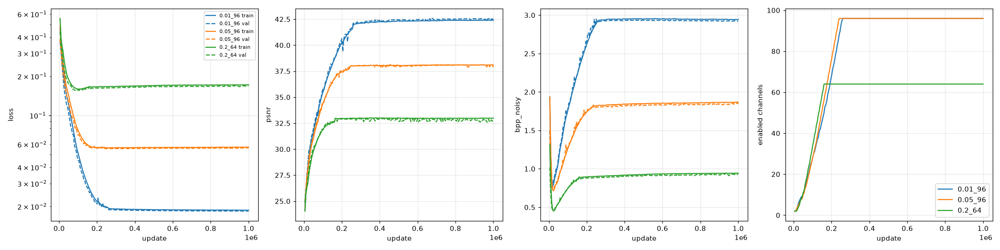
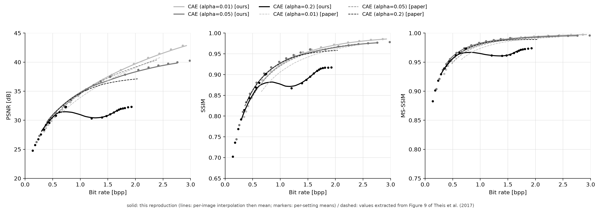
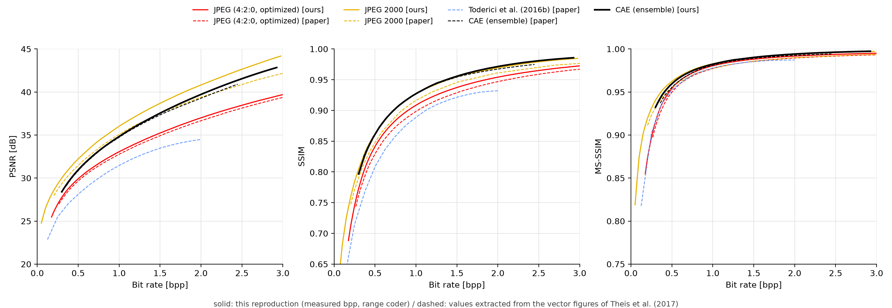

# report_001：Theis et al. の Compressive Autoencoder の再現実装と Figure 4 の再現

## 1．概要

Theis et al.（ICLR 2017）の Compressive Autoencoder（CAE）を PyTorch で再現実装し，低・中・高ビットレート向けの 3 モデルを各 1,000,000 更新まで学習した．
式(9)のスケールパラメータ $`\lambda`$ の微調整と補間により各モデルで 22 通りのレート設定を作り，Kodak PhotoCD 24 枚（Kodak24）を実際にレンジコーダで符号化・復号して評価した．
論文と同じ方法でアンサンブルを選択し，Figure 4 形式のレート・歪み曲線を作成した（図1）．

結論として，再現した CAE（アンサンブル）の平均曲線は論文の CAE と PSNR で 1.0 bpp 以下では $`\pm 0.12`$ dB 以内，SSIM で 0.003 以内に一致した．
一方，同一の評価環境で計測した JPEG 2000（OpenJPEG）は論文の JPEG 2000 より PSNR で 0.7〜1.6 dB 高く，これと比べると CAE は PSNR で 1.0〜1.5 dB 劣り，SSIM はほぼ同等であった．
したがって，「CAE は PSNR で JPEG 2000 と同程度で，SSIM で上回る」という論文の結論は，論文の JPEG 2000 の値に対しては再現されたが，現在の JPEG 2000 実装に対しては PSNR で再現されなかった．
また，論文 Figure 9 にみられる「低ビットレートモデルの $`\lambda`$ を大きくして高レート側へ拡張する」ことは再現できなかった（5 章）．

## 2．実装と論文との一致点・相違点

実装は `programs/ex001_kodak_cae/` にあり，構成と実行方法は `document.md` に記載した．
表1に，論文に明記された仕様と，本実装での推定・代替仕様を分けて示す．

**表1　論文の仕様と本実装の対応**

| 項目 | 論文の記述 | 本実装 | 区分 |
| :---: | :--- | :--- | :---: |
| Encoder | normalize → mirror-pad → conv 64×5×5/2 → conv 128×5×5/2 → Residual Block×3 → conv C×5×5/2 → round（Figure 2） | 同左．矢印の塗り分けから，LeakyReLU は 64/128 ch の畳み込みと各ブロックの 1 層目の後のみ | 一致 |
| Decoder | subpix 512×3×3/2 → Residual Block×3 → subpix 256×3×3/2 → subpix 12×3×3/2 → denormalize → clip | 同左（LeakyReLU は各ブロック 1 層目と subpix 256 の後） | 一致 |
| 畳み込みの padding | Encoder は mirror-pad と valid 畳み込み，Decoder は zero padding | 同左．ミラーパディング幅 35 px（出力が入力の 1/8 になる値），skip 接続は中央で切り出し | 一部推定 |
| LeakyReLU の傾き，重み初期化 | 記載なし（Theano/Lasagne を使用） | Lasagne の既定値（傾き 0.01，Glorot uniform，バイアス 0） | 推定 |
| 正規化 | チャネルごとに平均 0・分散約 1 にする固定の正規化 | 学習データの RGB 各チャネルの平均・標準偏差（mean ≈ [114.5, 111.5, 103.0]，std ≈ [72.2, 68.7, 74.3]） | 一致 |
| 量子化と STE | 順伝播は丸め，逆伝播は恒等写像の微分（式(3)） | 同左 | 一致 |
| クリップ | 0〜255 にクリップし，微分は 1（式(14)） | 同左 | 一致 |
| GSM | チャネルごとに独立，6 スケール，log-weight と log-precision で最適化（式(12)） | 同左．初期の標準偏差は 0.2〜20 の対数等間隔 | 一部推定 |
| レート推定 | $`-\log_2 q([f(\mathbf x)] + \mathbf u)`$，$`\mathbf u \sim U[-0.5, 0.5)`$（式(8)） | 同左 | 一致 |
| 損失 | 式(16)：$`\frac{\alpha}{N}(-\ln q) + \frac{1-\alpha}{1000 M}\|\mathbf x - \hat{\mathbf x}\|^2`$ | 同左（画素値 0〜255，$`N`$ は係数の数，$`M`$ は画素数の 3 倍） | 一致 |
| Incremental Training | 2 係数から開始し，改善が閾値未満になったら 1 つ有効化（式(13)） | マスクはチャネル単位．1,000 更新ごとに直前の 1,000 更新と平均損失を比べ，相対改善率が 1% 未満なら追加（追加後 2,000 更新は判定しない）．式(13)どおり無効なチャネルのレート $`-\ln q(0+u)`$ も損失に含める | 閾値は推定 |
| 学習率 | Adam，$`10^{-4}`$，全係数の有効化後 $`10^{-5}`$，最大 $`10^6`$ 更新 | 同左（1,000,000 更新まで実施） | 一致 |
| スケール微調整 | λ 以外を固定し，初期学習率 $`10^{-3}`$ を $`\tau^\kappa/(\tau+t)^\kappa`$（$`\kappa=0.8, \tau=1000`$）で減衰，10,000 更新．λ は log-scale で，チャネルごと（空間方向で共有） | 同左．目標 α は 0.002, 0.005, 0.01, 0.02, 0.05, 0.1, 0.2, 0.4, 0.7, 0.85, 0.95 の 11 通り．隣接する設定の log-scale の中点を補間設定とする | 目標 α は推定 |
| エントロピー符号化 | 学習データの係数の Laplace 平滑化ヒストグラム + kazuho/rangecoder | チャネルごとの Laplace 平滑化ヒストグラム + constriction の RangeEncoder．範囲外の値はエスケープ記号の後に 16 bit で符号化 | 代替実装 |
| アンサンブル | 画像・ビットレートごとに歪み最小のモデルを選択し，1 byte を加算 | 同左（歪みは MSE，選択は bpp 格子上での補間値で行う） | 一致 |
| 学習データ | Flickr の CC 画像 434 枚（1536×1536 以下に縮小，PNG） | DIV2K train 800 枚を長辺 1536 px 以下に縮小（Lanczos）．検証は DIV2K valid 100 枚から固定の 200 パッチ | 代替 |
| データ拡張 | 記載なし（128×128 の切り出しのみ） | ランダム切り出しのみ | 一致 |
| 数値精度 | 記載なし | 学習は TF32，評価は FP32．決定論的アルゴリズムを有効化（ミラーパディングの逆伝播のみ非決定論で警告扱い） | — |

## 3．学習データと学習条件

論文の Flickr 434 枚は，画像リスト・コードとも公開されていないことを確認した．
そのため DIV2K（train 800 枚，valid 100 枚）を代替とした．
論文とは画像数（434 枚に対して 800 枚）と画像の内容・出典が異なるため，学習条件は論文と同一ではない．
Kodak24 は評価にのみ用い，学習・検証・ハイパーパラメータの決定には用いていない．
ただし，微調整の目標 α に 0.85 と 0.95 を追加したのは，Kodak24 で最も符号量の大きい画像（kodim13）が論文と同程度の低レートまで下がらなかったためである．
これはモデルのパラメータではなくレート設定の範囲の決定であるが，Kodak24 の結果を見て決めた点を明記する．

学習条件は batch size 32（勾配蓄積なし，実効 batch size 32），128×128 の RGB パッチ，Adam，1 エポック = 5,000 更新 × 200 エポック = 1,000,000 更新，seed 0 である．
RTX 3090 では 1 モデルあたりの VRAM 使用量が約 2 GB だったため，3 モデルを並列に学習した（各約 6.6 更新/秒）．
実行条件は各モデルの `config.json` に保存した．

## 4．学習完了状況

3 モデルとも 1,000,000 更新を完了した（表2）．
非有限の損失は 3 モデルとも 0 回で，発散の警告も出なかった．

**表2　学習の完了状況（最終エポックの検証値は 128×128 パッチ 200 枚での値）**

| モデル | α | 潜在チャネル数 | 全チャネル有効化（学習率 $`10^{-5}`$ への切替） | 学習時間 | 検証 PSNR [dB] | 検証の推定 bpp |
| :---: | :---: | :---: | :---: | :---: | :---: | :---: |
| 高ビットレート | 0.01 | 96 | 256,000 更新 | 43.4 h | 42.40 | 2.921 |
| 中ビットレート | 0.05 | 96 | 239,000 更新 | 43.5 h | 37.88 | 1.839 |
| 低ビットレート | 0.2 | 64 | 160,000 更新 | 43.1 h | 32.65 | 0.929 |

図2に学習曲線を示す．
学習と検証の損失はほぼ一致しており，過学習はみられない．
全チャネルの有効化と学習率の切替の後は，損失・PSNR・レートがほぼ横ばいである．
これは論文の「通常はもっと早く良い性能に達した」という記述と整合する．
全チャネルの有効化には 16〜26 万更新を要し，論文 Figure 3B の 11.6 万更新より遅かった．
これは Incremental Training の閾値（推定仕様）の違いによると考えられる．
初期の約 2 万更新は，無効なチャネルのレート項（GSM が一様雑音 $`u`$ に適合する過程）による損失の減少が大きく，チャネルの追加がほとんど起きなかった．
α = 0.2 のモデルでは損失が約 10 万更新で最小となり，その後わずかに増加した．
チャネルを追加するたびに，歪みの減少よりレートの増加が上回ったと考えられる．



図2：学習曲線（左から損失，PSNR，推定 bpp（雑音付き連続近似），有効チャネル数．実線は学習，破線は検証）．

## 5．Kodak24 による各モデル・レート設定の定量評価

各モデルについて，λ = 1 の基本設定，微調整した 11 設定，補間した 10 設定の計 22 設定を評価した．
すべての画像・設定で，復号した係数が符号化前の係数と完全に一致することを確認した．
画像別の評価は `outputs/ex001_kodak_cae/CAE/{α}_{ch}/0/kodak/per_image.csv`，設定ごとの平均は同ディレクトリの `summary.csv` にあり，復元画像（PNG）とビットストリームも同ディレクトリに保存した．

bpp の分母は RGB 画像の画素数 $`H \times W`$ であり，実測 bpp には論文と同様にモデル選択の 1 byte（Kodak24 では 0.00002 bpp）を含めた．
画像サイズ等の 6 byte のヘッダは JPEG・JPEG 2000 と同様に数えず，含めた値は `bpp_file` 列に記録した．
レンジコーダの実測符号長はヒストグラムによる理想符号長の 1.0003 倍であった．
GSM による推定 bpp は，基本設定では実測 bpp の 1.02〜1.07 倍であった．
一方，λ を小さくした低レート設定では実測の 2〜3 倍に達した（例：α = 0.01 のモデルを目標 α = 0.7 に微調整した設定では実測 0.540 bpp に対し推定 1.412 bpp）．
これは GSM を固定したまま λ を変えたため GSM が係数の分布と合わなくなる一方，ヒストグラムは設定ごとに作り直しているためである．
推定 bpp による参考図は `figure4_estimated.png` に示した．

表3に主な設定の結果（24 枚の平均）を示す．

**表3　各モデルの主なレート設定の結果（Kodak24 の平均，実測 bpp）**

| モデル | 設定 | bpp | 推定 bpp（GSM） | PSNR [dB] | SSIM | MS-SSIM |
| :---: | :---: | :---: | :---: | :---: | :---: | :---: |
| α=0.01, 96ch | 目標 α=0.002 | 3.663 | 3.749 | 44.77 | 0.9906 | 0.9984 |
| α=0.01, 96ch | 基本（λ=1） | 2.643 | 2.679 | 42.18 | 0.9837 | 0.9969 |
| α=0.01, 96ch | 目標 α=0.2 | 1.116 | 1.650 | 35.22 | 0.9369 | 0.9846 |
| α=0.01, 96ch | 目標 α=0.7 | 0.540 | 1.412 | 30.61 | 0.8604 | 0.9583 |
| α=0.05, 96ch | 目標 α=0.01 | 2.415 | 2.558 | 39.44 | 0.9736 | 0.9949 |
| α=0.05, 96ch | 基本（λ=1） | 1.538 | 1.602 | 37.48 | 0.9609 | 0.9916 |
| α=0.05, 96ch | 目標 α=0.2 | 0.978 | 1.195 | 34.50 | 0.9306 | 0.9832 |
| α=0.05, 96ch | 目標 α=0.7 | 0.450 | 0.920 | 30.00 | 0.8543 | 0.9556 |
| α=0.2, 64ch | 目標 α=0.05 | 1.543 | 1.909 | 31.03 | 0.8951 | 0.9630 |
| α=0.2, 64ch | 基本（λ=1） | 0.741 | 0.784 | 32.30 | 0.9021 | 0.9736 |
| α=0.2, 64ch | 目標 α=0.7 | 0.345 | 0.526 | 28.37 | 0.8147 | 0.9393 |
| α=0.2, 64ch | 目標 α=0.95 | 0.139 | 0.435 | 24.76 | 0.7027 | 0.8826 |

図3に，各モデルの曲線を論文 Figure 9 と比較して示す．
λ を小さくして低レート側へ広げる方向は，3 モデルとも論文と同程度か，それ以上の性能であった．
しかし，α = 0.2 のモデルの λ を大きくして高レート側へ広げる方向では，レートが増えても PSNR が基本設定より下がった．
論文の α = 0.2 のモデルは 2.04 bpp・37.1 dB まで滑らかに伸びており，この点は再現できていない．
微調整の損失をみると，α = 0.2 のモデルの目標 α = 0.002 の設定では，歪み項が λ = 1 の 0.0514 から 0.0607 に増え，損失も λ = 1 の値（約 0.053）より悪い 0.065 で終わった．
丸めの STE による勾配は「λ を大きくして量子化を細かくすれば歪みが減る」ことを示すが，デコーダは学習中に整数値の入力しか見ていないため，整数以外の入力 $`[f(\mathbf x) \circ \lambda] / \lambda`$ に対して実際の歪みが増えたと考えられる．
論文でこの現象が起きなかった理由（学習データ，GSM の扱い，λ の初期化など）は特定できていない．
アンサンブルでは画像・レートごとに歪み最小のモデルが選ばれるため，この影響は Figure 4 にはほぼ現れない．
選択されたモデルの割合は，0.5 bpp 以下で α = 0.05 が 65%・α = 0.2 が 35%，1.0〜1.5 bpp で α = 0.01 が 53%・α = 0.05 が 44%，2.0 bpp 超では α = 0.01 が 98% であった．



図3：各モデルの曲線（実線：再現，線は画像ごとに補間してからの平均，点は設定ごとの平均．破線：論文 Figure 9 から抽出した値）．

## 6．論文 Figure 4 との比較

### 比較データの入手と評価方法

論文の値には，論文 PDF の Figure 4・Figure 9 と，著者が公開した補足資料（figshare 4210152）の画像別の図（`psnr_by_image.pdf` などの 24 枚分）を用いた．
これらは matplotlib のベクタ PDF であり，折れ線の頂点座標を目盛ラベルの位置による線形写像でデータ座標に変換して抽出した（`extract_paper_curves.py`）．
画素からの読み取りではないが，著者が数値表として公開したものではなく，図から抽出した値である．
画像別の曲線を「画像ごとに bpp の格子で線形補間し，24 枚で平均する」と，論文 Figure 4 の曲線と小数第 3 位まで一致した（例：CAE の 1.0 bpp で 34.738 と 34.730 dB）．
このことから，抽出が正確であることと，論文の平均化がこの方法であることを確認し，本実装の平均曲線も同じ方法で計算した．
Toderici et al.（2016b）は公開コードが TensorFlow の旧版向けで学習済みモデルの再現が難しいため，評価は行わず，論文の図から抽出した値のみを描いた．

JPEG（4:2:0，optimized）と JPEG 2000 は，同じ Kodak24・同じ指標の実装で自ら評価した（`baselines.py`）．
JPEG は Pillow（libjpeg-turbo，quality 1〜100，subsampling 4:2:0，optimize=True）で符号化し，DHT（Huffman テーブル）とエントロピー符号化データのみを数えた．
JPEG 2000 は Pillow（OpenJPEG，9/7 非可逆変換，MCT 有効，目標レート 37 通り）で符号化し，SOD 以降のタイルデータのみを数えた．
指標は，PSNR を RGB の MSE から，SSIM を scikit-image の既定値（RGB 各チャネル，7×7 窓）で，MS-SSIM を Toderici et al. の実装（`msssim.py`）を TensorFlow 非依存に移植したものでそれぞれ計算した．
SSIM の設定は論文に記載がないため，JPEG の論文値との差が最も小さい設定を候補から確認した．
その結果，ガウス窓よりも scikit-image の既定値が論文の実装（van der Walt et al., 2014）として自然であると判断した．
我々の JPEG は論文の JPEG より PSNR で約 +0.2〜0.3 dB，SSIM で約 +0.01 高く，差は全レートで同じ向きであった．
これは指標の定義ではなく，符号化器の版（2016 年当時の libjpeg 等）または符号長の数え方の差によると考えられる．
JPEG 2000 は論文の値より PSNR で 0.7〜1.6 dB 高く，論文で用いた符号化器（論文に記載なし）との差が大きい．

### 結果



図1：Kodak24 による Figure 4 形式の比較（実線：本再現で計測した値（実測 bpp），破線：論文の図から抽出した値）．PDF 版は `report_001_figures/figure4.pdf`．

**表4　Kodak24 の平均曲線の比較（bpp の格子上の値）**

| 曲線 | 指標 | 0.375 | 0.5 | 0.75 | 1.0 | 1.5 | 2.0 | 2.4 |
| :--- | :---: | :---: | :---: | :---: | :---: | :---: | :---: | :---: |
| CAE（再現） | PSNR | 29.48 | 30.94 | 33.14 | 34.83 | 37.54 | 39.72 | 41.21 |
| CAE（論文） | PSNR | 29.36 | 30.84 | 33.08 | 34.73 | 37.34 | 39.28 | 40.74 |
| JPEG 2000（本評価） | PSNR | 30.92 | 32.22 | 34.34 | 36.02 | 38.69 | 40.82 | 42.29 |
| JPEG 2000（論文） | PSNR | 30.22 | 31.46 | 33.46 | 35.07 | 37.53 | 39.40 | 40.57 |
| JPEG（本評価） | PSNR | 28.72 | 29.91 | 31.69 | 33.05 | 35.23 | 37.00 | 38.18 |
| Toderici et al.（論文） | PSNR | 26.98 | 28.10 | 29.98 | 31.46 | 33.47 | 34.48 | — |
| CAE（再現） | SSIM | 0.8270 | 0.8611 | 0.9030 | 0.9272 | 0.9556 | 0.9714 | 0.9793 |
| CAE（論文） | SSIM | 0.8296 | 0.8619 | 0.9030 | 0.9273 | 0.9542 | 0.9672 | 0.9742 |
| JPEG 2000（本評価） | SSIM | 0.8307 | 0.8618 | 0.9022 | 0.9271 | 0.9545 | 0.9694 | 0.9775 |
| JPEG 2000（論文） | SSIM | 0.8162 | 0.8475 | 0.8895 | 0.9162 | 0.9456 | 0.9611 | 0.9683 |
| CAE（再現） | MS-SSIM | 0.9455 | 0.9595 | 0.9746 | 0.9823 | 0.9902 | 0.9941 | 0.9959 |
| CAE（論文） | MS-SSIM | 0.9399 | 0.9555 | 0.9724 | 0.9812 | 0.9892 | 0.9925 | 0.9941 |
| JPEG 2000（本評価） | MS-SSIM | 0.9510 | 0.9623 | 0.9756 | 0.9828 | 0.9902 | 0.9938 | 0.9956 |

再現した CAE と論文の CAE の差は，PSNR で 1.0 bpp 以下では +0.06〜+0.12 dB，1.5 bpp 以上では +0.2〜+0.5 dB であった．
SSIM の差は 1.0 bpp 以下では 0.003 以内で，2 bpp 以上では再現の方が 0.004〜0.005 高かった．
MS-SSIM は全域で 0.001〜0.006 高かった．
ただし，JPEG の比較で示したように，我々の評価環境は論文より SSIM と MS-SSIM がやや高く出る傾向がある．
このため，SSIM と MS-SSIM の差の一部は評価環境によるものである可能性がある．

各手法の比較では，CAE は全域で JPEG と Toderici et al. を上回った．
論文の JPEG 2000 の値に対しては，CAE は PSNR でほぼ同等（低レートでわずかに劣り，高レートで上回る）で，SSIM で上回った．
これは論文の結論と一致する．
一方，本評価の JPEG 2000（OpenJPEG）に対しては，CAE は PSNR で 1.0〜1.5 dB 劣り，SSIM は 2.0 bpp 未満でほぼ同等，2.0 bpp 以上でわずかに上回るにとどまった．
CAE の曲線の範囲は 0.30〜2.93 bpp であり，論文（0.36〜2.45 bpp）より広い．

## 7．未再現の部分とその理由

1. 学習データが論文と異なる（Flickr 434 枚は非公開のため DIV2K 800 枚で代替した）．
2. α = 0.2 のモデルで，λ の微調整による高レート側への拡張が論文のように機能しなかった（5 章）．原因は特定できていない．
3. Incremental Training の閾値は論文に記載がなく，全チャネルの有効化が論文（11.6 万更新）より遅かった（16〜26 万更新）．
4. JPEG 2000 は論文で用いた符号化器が不明なため，論文の値と本評価の値が 0.7〜1.6 dB 異なり，CAE と JPEG 2000 の優劣の結論が符号化器に依存した．
5. Toderici et al.（2016b）は実行による評価を行わず，論文の図から抽出した値のみを用いた．
6. 論文の Figure 5・6 の主観評価（MOS テスト）と，Figure 3・10 の比較実験は対象外とした．
7. seed は 1 つ（seed 0）のみで，seed 間のばらつきは評価していない．

## 8．成果物

| 成果物 | 保存場所 |
| :--- | :--- |
| 実装コード | `programs/ex001_kodak_cae/*.py`，`tests/*.py`，`visualize_result.ipynb` |
| 設定・実行条件 | `outputs/ex001_kodak_cae/CAE/{α}_{ch}/0/config.json` |
| 学習済みモデル | 同 `final_model.pth`（1,000,000 更新時点），`best_model.pth`，`checkpoint.pth`（最適化状態を含む） |
| 学習ログ | 同 `log.json`（エポックごとの学習・検証の指標），`iter_log.csv`（100 更新ごと），`train_stdout.log` |
| スケール λ | 同 `scales/alpha_*.json` |
| 評価 CSV | 同 `kodak/summary.csv`（設定ごと），`kodak/per_image.csv`（画像別），`outputs/ex001_kodak_cae/baselines/*/per_image.csv` |
| 復元画像・ビットストリーム | 同 `kodak/reconstructions/{設定}/kodimXX.png`，`kodak/bitstreams/{設定}/kodimXX.bin` |
| 論文からの抽出値 | `outputs/ex001_kodak_cae/paper_values/{figure4,figure9,by_image}.csv` |
| 図 | `outputs/ex001_kodak_cae/figures/figure4.{png,pdf}`，`figure9.{png,pdf}`，`figure4_estimated.{png,pdf}`，`curves.csv` |

## 9．実行・再開コマンド

```bash
cd theis-cae
.venv_pytorch/bin/python programs/ex001_kodak_cae/data.py                 # DIV2K の前処理
.venv_pytorch/bin/python -m pytest tests -q                               # 学習前検証（16 件）
nohup setsid .venv_pytorch/bin/python programs/ex001_kodak_cae/train.py \
    > outputs/ex001_kodak_cae/train_main.log 2>&1 &                       # 学習（中断後は同じコマンドで再開）
.venv_pytorch/bin/python programs/ex001_kodak_cae/finetune_scales.py      # λ の微調整（済みの α はスキップ）
.venv_pytorch/bin/python programs/ex001_kodak_cae/evaluate.py             # Kodak24 の評価（済みの設定はスキップ）
.venv_pytorch/bin/python programs/ex001_kodak_cae/baselines.py            # JPEG / JPEG 2000
.venv_pytorch/bin/python programs/ex001_kodak_cae/extract_paper_curves.py # 論文値の抽出
.venv_pytorch/bin/python programs/ex001_kodak_cae/plot_figure4.py         # Figure 4 / 9
```

学習は `checkpoint.pth`（モデル，Adam の状態，Incremental Training の状態，乱数状態，ログ）から自動で再開し，`finished.json` がある条件はスキップする．

## 10．次に改善すべき点

以下は今回の結果から得た検討候補であり，いずれも未実施である．

1. α = 0.2 のモデルの高レート側への拡張が失敗する原因の調査．λ を大きくした設定での歪みの増加が，デコーダが整数以外の入力に対応できないことによるのかを確かめる必要がある．例えば，微調整の損失の推移（`scales/alpha_*.json` の `history`）の分析や，λ 微調整時の歪みを STE ではなく実際の値で評価する診断が考えられる．
2. Incremental Training の閾値（1,000 更新あたり 1%）の感度の確認．論文 Figure 3B のように約 12 万更新で全係数が有効になる設定との比較．
3. 学習データの影響の確認．DIV2K 800 枚から 434 枚を抽出した学習との比較．
4. JPEG 2000 の符号化器（Kakadu，旧版 OpenJPEG など）の違いが比較結論に与える影響の確認．
5. seed を増やした学習による，再現性（ばらつき）の評価．
6. 1,000,000 更新のうち後半はほぼ横ばいであったため，学習率を切り替えた後の更新数を減らした場合の性能低下の確認（計算時間の削減）．
