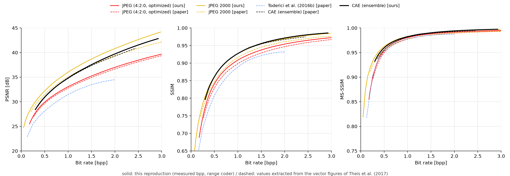

# theis-cae：Compressive Autoencoder の PyTorch による再現実装

Theis et al.（ICLR 2017）「Lossy Image Compression with Compressive Autoencoders」[1] の Compressive Autoencoder（CAE）を PyTorch で再現し，Kodak PhotoCD 24 枚（Kodak24）で論文の Figure 4（レート・歪み曲線）を再現したリポジトリである．
3 つのモデルを論文と同じ最大 1,000,000 更新まで学習し，実際にレンジコーダで符号化・復号して計測したビットレートで評価した．



Kodak24 による Figure 4 形式の比較．実線は本実装で計測した値，破線は論文の図から抽出した値である．

## 主な結果

再現した CAE の平均曲線は，論文の CAE と PSNR で 1.0 bpp 以下では約 0.1 dB，SSIM で 0.003 以内の差であった．

| 曲線 | 0.5 bpp | 1.0 bpp | 2.0 bpp |
| :--- | :---: | :---: | :---: |
| CAE（本実装），PSNR [dB] | 30.94 | 34.83 | 39.72 |
| CAE（論文），PSNR [dB] | 30.84 | 34.73 | 39.28 |
| CAE（本実装），SSIM | 0.861 | 0.927 | 0.971 |
| CAE（論文），SSIM | 0.862 | 0.927 | 0.967 |

一方，次の 2 点は論文と異なる結果となった．
詳細と考察は [.reports/report_001.md](.reports/report_001.md) に記載した．

- 本実装で評価した JPEG 2000（OpenJPEG）は論文の JPEG 2000 より PSNR で 0.7〜1.6 dB 高く，これと比べると CAE は PSNR で 1.0〜1.5 dB 劣る．CAE と JPEG 2000 の優劣は JPEG 2000 の符号化器に依存する．
- 低ビットレートのモデル（$`\alpha = 0.2`$）は，スケールパラメータ $`\boldsymbol\lambda`$ の微調整によって高レート側へ広げることができなかった．

## 論文との主な違い

| 項目 | 論文 | 本実装 |
| :--- | :--- | :--- |
| 学習データ | Flickr の画像 434 枚（非公開） | DIV2K [2] の学習用 800 枚（長辺 1536 px 以下に縮小） |
| 実装 | Theano，Lasagne | PyTorch |
| エントロピー符号化 | kazuho/rangecoder | constriction（range coder） |
| 論文に記載のない仕様 | ― | LeakyReLU の傾き，重みの初期化，ミラーパディング幅，Incremental Training の判定の閾値，微調整の目標 $`\alpha`$ などを推定して決定 |

論文の値（CAE，JPEG，JPEG 2000，Toderici et al.）は，論文と著者の補足資料 [3] のベクタ PDF から曲線の座標を数値として抽出したものであり，著者が公開した数値表ではない．
Toderici et al. の手法は実行しておらず，論文から抽出した値のみを用いている．

## 動作環境

- WSL2 Ubuntu，Python 3.12，PyTorch 2.11.0（CUDA 12.8），NVIDIA RTX 3090 で動作を確認した．
- 1 モデルの学習に約 2 GB の VRAM を用い，3 モデルを並列に学習すると各約 43 時間を要した．

## セットアップ

```bash
uv venv .venv_pytorch --python 3.12
uv pip install --python .venv_pytorch/bin/python \
    --extra-index-url https://download.pytorch.org/whl/cu128 -r requirements_pytorch.txt
uv pip install --python .venv_pytorch/bin/python pymupdf    # 論文の図から値を抽出する場合
```

データは次のように配置する．
`datasets/` は Git の管理対象外である．

| データ | 配置先 | 入手先 |
| :--- | :--- | :--- |
| DIV2K（`DIV2K_train_HR.zip`，`DIV2K_valid_HR.zip`） | `datasets/raw/div2k/` | https://data.vision.ee.ethz.ch/cvl/DIV2K/ |
| Kodak24（`kodim01.png`〜`kodim24.png`） | `datasets/raw/kodak/` | http://r0k.us/graphics/kodak/ |

## 実行方法

```bash
.venv_pytorch/bin/python programs/ex001_kodak_cae/data.py                 # DIV2K の縮小と正規化統計量の計算
.venv_pytorch/bin/python -m pytest tests -q                               # 学習前の検証
nohup setsid .venv_pytorch/bin/python programs/ex001_kodak_cae/train.py \
    > outputs/ex001_kodak_cae/train_main.log 2>&1 &                       # 3 モデルの学習（中断後は同じコマンドで再開）
.venv_pytorch/bin/python programs/ex001_kodak_cae/finetune_scales.py      # スケールパラメータの微調整
.venv_pytorch/bin/python programs/ex001_kodak_cae/evaluate.py             # Kodak24 の符号化・復号と評価
.venv_pytorch/bin/python programs/ex001_kodak_cae/baselines.py            # JPEG と JPEG 2000 の評価
.venv_pytorch/bin/python programs/ex001_kodak_cae/extract_paper_curves.py # 論文の図からの値の抽出
.venv_pytorch/bin/python programs/ex001_kodak_cae/plot_figure4.py         # Figure 4 形式の図の作成
```

学習は `checkpoint.pth` から自動で再開し，学習を終えた条件はスキップする．
結果は `outputs/ex001_kodak_cae/` に保存される．

## ファイル構成

| パス | 内容 |
| :--- | :--- |
| `programs/ex001_kodak_cae/` | モデル，データ，学習，スケールの微調整，エントロピー符号化，評価，作図のプログラム |
| `programs/slides/` | ゼミ発表用スライドの生成プログラム |
| `tests/` | 学習前の検証（形状，勾配の近似，GSM，損失，過学習，符号化・復号，チェックポイント） |
| `visualize_result.ipynb` | 学習曲線と Figure 4 の可視化 |
| `theis_cae_reproduction.pptx`，`.pdf` | ゼミ発表用のスライド |
| `.reports/` | 実験レポート（`report_001.md` が再現実験，`report_002.md` がスライドの作成記録） |
| `document.md` | 各ファイルの役割，依存関係，実行方法の詳細 |

## 参考文献

[1] L. Theis, W. Shi, A. Cunningham, and F. Huszár, “Lossy image compression with compressive autoencoders,” Proc. International Conference on Learning Representations (ICLR), 2017．

[2] E. Agustsson and R. Timofte, “NTIRE 2017 challenge on single image super-resolution: dataset and study,” Proc. IEEE CVPR Workshops, 2017．

[3] L. Theis, et al., Supplementary material，https://figshare.com/articles/supplementary_zip/4210152．
