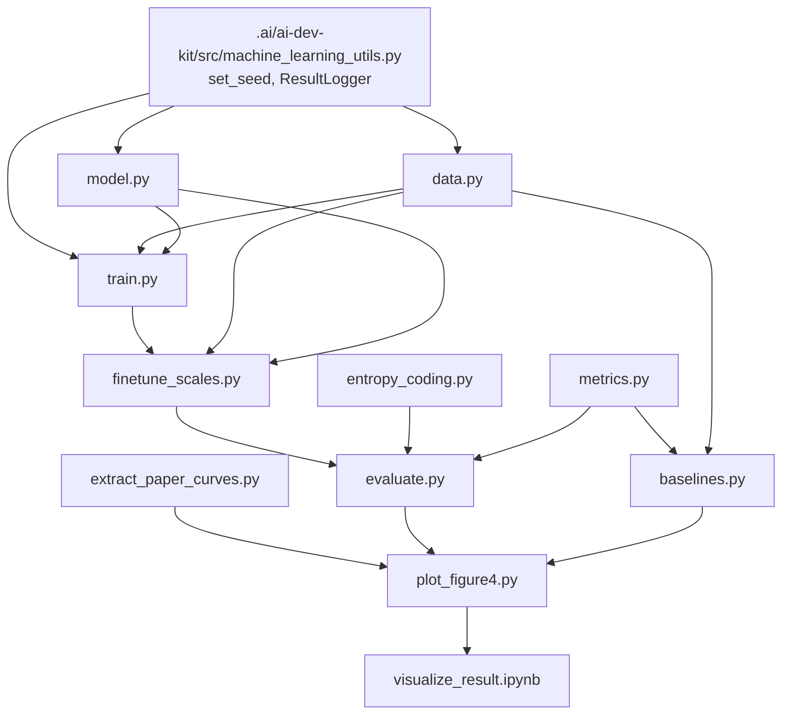

# theis-cae：Compressive Autoencoder（Theis et al., ICLR 2017）の再現実装

本リポジトリは，Theis et al.（2017）「Lossy Image Compression with Compressive Autoencoders」の Compressive Autoencoder（CAE）を PyTorch で再現し，Kodak PhotoCD 24 枚（Kodak24）で論文 Figure 4 形式のレート・歪み曲線を作成するためのものである．
実験の内容と結果は `.reports/report_001.md` に記録する．

## ディレクトリとファイルの役割

```text
./
├── reference/theis2017.pdf            # 参考論文
├── programs/ex001_kodak_cae/          # 実験 ex001 のプログラム
│   ├── model.py                       # CAE（Encoder, Decoder, Residual Block, Sub-pixel Conv, STE, GSM, λ, マスク）
│   ├── data.py                        # DIV2K の前処理（縮小・連結・正規化統計量），DataLoader，Kodak の読み込み
│   ├── train.py                       # 式(16)の損失，Incremental Training，学習ループ，チェックポイント・再開，並列学習
│   ├── finetune_scales.py             # 式(9)のスケール λ の微調整（λ 以外は固定）
│   ├── entropy_coding.py              # Laplace 平滑化ヒストグラム + レンジコーダ（constriction）による符号化・復号
│   ├── metrics.py                     # PSNR，SSIM（scikit-image），MS-SSIM（Toderici et al. の実装の移植）
│   ├── evaluate.py                    # Kodak24 の評価（実測 bpp，推定 bpp，PSNR，SSIM，MS-SSIM，復元画像）
│   ├── baselines.py                   # JPEG（4:2:0, optimized）と JPEG 2000 の評価
│   ├── extract_paper_curves.py        # 論文・著者補足資料のベクタ PDF から曲線の数値を抽出
│   └── plot_figure4.py                # アンサンブル選択と Figure 4 / Figure 9 形式の作図
├── tests/                             # 学習前検証（pytest）
│   ├── test_model.py                  # 形状，STE・クリップの勾配，GSM の安定性・正規化，損失の各項，過学習
│   ├── test_entropy_coding.py         # 符号化・復号の一致，符号長，モデルを通した再構成の一致
│   └── test_checkpoint.py             # チェックポイントの保存と再開
├── visualize_result.ipynb             # 学習曲線（seed 間の平均・標準偏差）と Figure 4 の可視化
├── datasets/                          # データ（Git 管理外）
│   ├── raw/{kodak,div2k,theis2017_supplementary}/
│   └── ex001_kodak_cae/div2k_max1536/ # 縮小済み DIV2K（train.npy, valid.npy, stats.json）
├── outputs/ex001_kodak_cae/           # 実験結果（Git 管理外）
│   ├── CAE/{α}_{ch}/{seed}/           # 学習結果（config.json, log.json, iter_log.csv, train_stdout.log,
│   │                                  #   checkpoint.pth, best_model.pth, final_model.pth, finished.json,
│   │                                  #   scales/alpha_*.json, kodak/）
│   ├── baselines/{JPEG,JPEG2000}/per_image.csv
│   ├── paper_values/{figure4,figure9,by_image}.csv
│   └── figures/                       # figure4.{png,pdf}, figure9.{png,pdf}, curves.csv など
├── requirements_pytorch.txt           # 依存ライブラリ
└── .orders/, .reports/                # 指示書とレポート
```

## プログラムの依存関係



処理の流れは，`data.py`（前処理）→ `train.py`（3 モデルの学習）→ `finetune_scales.py`（各モデルで複数の α に対する λ の微調整）→ `evaluate.py`（Kodak24 の符号化・復号と評価）→ `plot_figure4.py`（アンサンブル選択と作図）である．
`baselines.py` と `extract_paper_curves.py` は学習と独立に実行できる．

外部モジュールとして，`set_seed` と `ResultLogger` を `.ai/ai-dev-kit/src/machine_learning_utils.py` から読み込む．
エントロピー符号化には constriction（range coder），SSIM には scikit-image，論文 PDF の解析には PyMuPDF を用いる．

## 環境構築

```bash
uv venv .venv_pytorch --python 3.12
uv pip install --python .venv_pytorch/bin/python \
    --extra-index-url https://download.pytorch.org/whl/cu128 -r requirements_pytorch.txt
uv pip install --python .venv_pytorch/bin/python pymupdf
.venv_pytorch/bin/python -m ipykernel install --user --name venv_pytorch --display-name "Python (.venv_pytorch)"
```

動作確認環境は WSL2 Ubuntu，Python 3.12.14，PyTorch 2.11.0+cu128，NVIDIA RTX 3090 である．

## 実行方法

```bash
# データの準備（DIV2K と Kodak を datasets/raw/ に配置した後）
.venv_pytorch/bin/python programs/ex001_kodak_cae/data.py
# 学習前検証
.venv_pytorch/bin/python -m pytest tests -q
# 3 モデルの並列学習（中断後に同じコマンドで checkpoint.pth から自動再開，完了済みの条件はスキップ）
nohup setsid .venv_pytorch/bin/python programs/ex001_kodak_cae/train.py > outputs/ex001_kodak_cae/train_main.log 2>&1 &
# 特定条件のみ
.venv_pytorch/bin/python programs/ex001_kodak_cae/train.py --only 0.2_64
# λ の微調整（final_model.pth が無い場合は checkpoint.pth の重みを用いる）
.venv_pytorch/bin/python programs/ex001_kodak_cae/finetune_scales.py
# Kodak24 の評価，ベースライン，論文値の抽出，作図
.venv_pytorch/bin/python programs/ex001_kodak_cae/evaluate.py
.venv_pytorch/bin/python programs/ex001_kodak_cae/baselines.py
.venv_pytorch/bin/python programs/ex001_kodak_cae/extract_paper_curves.py
.venv_pytorch/bin/python programs/ex001_kodak_cae/plot_figure4.py
# 可視化ノートブックの実行
.venv_pytorch/bin/jupyter nbconvert --to notebook --execute --inplace visualize_result.ipynb
```

## 実験結果と文書の保存場所

学習結果は `outputs/ex001_kodak_cae/CAE/{α}_{ch}/{seed}/` に，評価 CSV と復元画像は同ディレクトリの `kodak/` に，図は `outputs/ex001_kodak_cae/figures/` に保存される．
レポートは `.reports/report_{n:03}.md`，指示書は `.orders/order_{n:03}.md` に保存する．

## API キーと設定ファイル

本実験は API キーを必要としない．
プロジェクトルートには `tokens.json` が存在せず，暗号化された `tokens.json.enc` のみが存在する．
`tokens.json` は `.gitignore` に登録済みである．

## Git 管理上の注意

`datasets/`，`outputs/`，`.venv_*` は `.gitignore` により管理対象外である．
学習済みモデル（`*.pth`）を Git で管理する場合は Git LFS を用いる．
`.ai/` 以下はサブモジュールであり，本実験では変更しない．
